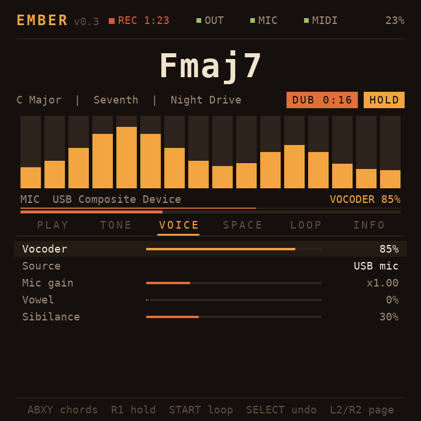

# Ember

[](https://github.com/ruderigo/ember/actions/workflows/ci.yml)
[](https://github.com/ruderigo/ember/releases/latest)
[](LICENSE)

Warm analog pads and a vocoder for the R36Max (ArkOS4Clone). Plays from the
handheld's buttons or a USB MIDI keyboard, vocodes a USB mic or a built-in
vowel voice, and loops and records what you play.



## Install or update

Grab the latest package from
[Releases](https://github.com/ruderigo/ember/releases/latest). It includes a
prebuilt binary for ArkOS4Clone / dArkOS (Debian trixie, arm64).

**Over Wi-Fi**, from an SSH session on the handheld:

```sh
cd /roms/ports && curl -L https://github.com/ruderigo/ember/releases/latest/download/ember-arkos-arm64.tar.gz | tar xz --no-same-owner
```

**With the SD card**: unzip `ember-arkos-arm64.zip` into the `ports` folder.

**From source**: copy `Ember.sh` to `/roms/ports/` and the rest of this repo
to `/roms/ports/ember/`, then run `make` there. The handheld already has
gcc and the SDL2 and ALSA headers.

Then restart EmulationStation (or reboot) and launch **Ember** from Ports.
Updating keeps your settings, presets and recordings.

To see error messages on a first run, start it over SSH instead (this frees
the screen and audio from EmulationStation):

```sh
sudo systemctl stop emulationstation
cd /roms/ports/ember && ./ember
sudo systemctl start emulationstation
```

## Controls

| Button | Action |
|---|---|
| A / B / X / Y | Play chords I, IV, V, vi in the current key |
| L1 + A / B / X / Y | Play chords ii, iii, vii, I (octave up) |
| R1 | Hold: chords keep sounding after you let go |
| START | Looper: record, then play, then overdub, then play |
| SELECT (tap) | Undo the last overdub (tap again to redo) |
| SELECT (hold) | Clear the loop |
| D-pad up/down | Choose a setting |
| D-pad left/right | Change it (hold to repeat) |
| L2 / R2 | Previous / next page |
| Left stick | X: vowel, Y: filter sweep |
| Right stick | X: pitch bend, Y (up): reverb swell |
| SELECT + START | Quit |

Pages: **PLAY** (preset, key, scale, chord type, octave, bass, volume),
**TONE** (oscillators, filter, envelopes, tape), **VOICE** (vocoder),
**SPACE** (chorus, reverb), **LOOP** (looper and recorder), **INFO**
(devices, latency, raw button numbers).

## Looper

1. Press **START** to record. The pill shows **REC** and the time.
2. Press **START** again to close the loop. It starts playing right away.
3. Press **START** to overdub (**DUB**), play along, then **START** to go
   back to playing.
4. Tap **SELECT** to undo the last overdub, hold it to clear everything.

Loops can be up to 64 seconds. Everything is captured, including the mic
through the vocoder and the reverb, so the loop sounds like what you heard.
On the LOOP page, **Overdub keep** sets how much of the old loop survives
each overdub pass: 100% keeps it all, lower values let older layers slowly
fade, which suits evolving ambient loops.

## Recording to the SD card

On the LOOP page:
- **Record to SD**: press RIGHT to start recording everything you hear, LEFT
  to stop. A red **REC** timer shows in the header.
- **Save loop to SD**: press RIGHT to save the current loop as a WAV.

Files go to `/roms/ports/ember/recordings/` (48 kHz, 16-bit stereo). Copy
them to your Mac with:

```sh
scp 'ark@r36max.local:/roms/ports/ember/recordings/*.wav' ~/Music/
```

## MIDI keyboard

Plug it in any time; Ember connects automatically. Keys play the pads
(8 voices), and these controllers work out of the box:

| CC | Controls |
|---|---|
| 1 mod wheel | Vibrato |
| 2 / 11 | Vocoder blend |
| 7 | Volume |
| 64 | Sustain pedal |
| 71 | Resonance |
| 72 / 73 | Release / attack |
| 74 | Cutoff |
| 91 / 93 | Reverb / chorus |
| Pitch bend | +/- 2 semitones |

The INFO page shows the last CC number received, so you can set your
Nektar's faders to send these. MIDI learn comes in v0.2.

## Vocoder

Set **VOICE > Vocoder** above 0%. **Source** picks:
- **USB mic**: sing or speak while playing chords. The mic is found
  automatically and can be plugged in or out while Ember runs.
- **Vowel voice**: a built-in choir-like voice that follows your chords.
  Morph vowels with the left stick or the Vowel setting.

Try the **Tape Choir** (vowel voice) and **Robot Hymn** (mic) presets.

## Presets

16 factory presets: Ember Pad, Velvet Strings, Tape Choir, Robot Hymn,
Slow Bloom, Warm Drone, Juno Dawn, Brass Haze, Felt Keys, Midnight Choir,
Whisper Pad, Mic Choir, Cassette Sunset, Deep Sub Drone, Shimmer Wash and
Soft Keys. Mic Choir and Robot Hymn expect the USB mic.

A preset stores the sound (TONE, VOICE and SPACE settings, plus chord type
and bass note). Key, scale, octave and volume stay as you set them.

**Your own presets** (PLAY page, 8 slots):
1. Shape a sound. A `*` after the preset name means you've changed it.
2. On **Save to**, pick a slot with LEFT/RIGHT.
3. On **Save preset**, press RIGHT. If the slot is taken, press RIGHT again
   within 3 seconds to overwrite it.

Saved slots appear in the **Preset** list after the factory ones. They live
in `user_presets.cfg`; edit a slot's `name=` line over SSH to rename it.

## Files

- `ember.cfg`: your settings, saved automatically.
- `user_presets.cfg`: your saved presets.
- `recordings/`: your recordings and saved loops.
- `controls.cfg`: button numbers. If a button does the wrong thing, open the
  INFO page, press it, read the raw number, and edit this file. Set
  `use_gamecontroller=0` to force the raw numbers.
- `ember.log`, `build.log`: for troubleshooting.

## Troubleshooting

- **OUT is red / "busy"**: something else has the speaker. Ember keeps
  retrying, so quitting the other app is enough.
- **Crackles**: run with a bigger buffer, e.g. edit Ember.sh to
  `EMBER_PERIOD=512 ./ember`. The INFO page counts dropouts (xruns).
- **Other overrides**: `EMBER_OUT` (output device, default `plughw:0,0`) and
  `EMBER_MIC` (force a capture device, e.g. `plughw:1,0`).
- **Mic and keyboard together**: use a powered USB hub. The handheld's port
  may not supply enough power for both.

## Development

- `make` builds, `make test` runs the engine, looper and recorder tests,
  `make package` builds the release packages into `dist/`.
- CI builds and tests every push on arm64 and x86_64 in Debian trixie, the
  same base as ArkOS4Clone, and uploads the packages as artifacts.
- To release: update `VERSION` and `CHANGELOG.md`, commit, then tag
  `v` + version (`git tag -a v0.3.0 -m "Ember 0.3.0" && git push --tags`).
  The release workflow checks the tag matches `VERSION`, builds and tests
  on arm64, and publishes the packages with notes from the changelog.

## Credits

The on-screen font is DejaVu Sans Mono (Bitstream Vera / DejaVu license),
embedded as bitmaps in `src/font.h` by `tools/mkfont.py`.

## Testing on a computer

`make test` renders a demo progression to `ember_demo.wav`, reports
speed, and checks the looper (record, overdub, undo, redo, clear). On a Linux desktop, `EMBER_WINDOWED=1 ./ember` runs the full app
with keyboard controls: Z X A S = A B X Y, Q = L1, W = R1, 1/2 = L2/R2,
arrows = D-pad, Esc = quit.
